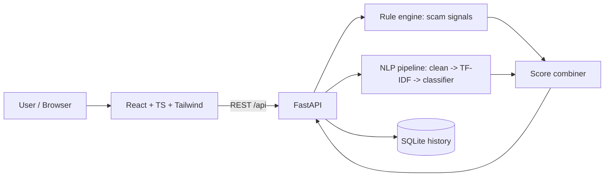
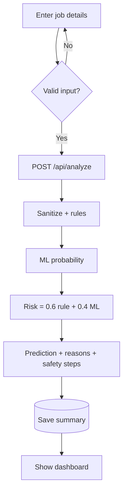

# JobShield AI – AI-Based Fake Job Detection System
*Detect Fake Jobs. Protect Your Career.*

## Abstract
JobShield AI analyses job postings and recruitment messages and returns an explainable risk assessment (Likely Genuine / Suspicious / Potentially Fake). It combines a TF-IDF + scikit-learn text classifier with a rule engine that detects scam signals (upfront fees, sensitive-data requests, unrealistic pay, suspicious contacts, pressure tactics). Results, reasons and safety steps are shown on a React dashboard and summaries are stored in SQLite.

## Problem Statement
Students and freshers lose money and personal data to fake job offers. Most people cannot quickly tell a scam from a real offer, and simple "fake/real" labels do not teach them why.

## Objectives
1. Classify job postings using NLP + ML. 2. Explain every prediction through detected warning signs. 3. Provide safety guidance. 4. Keep a private history. 5. Be honest about limits (no claimed accuracy that was not measured).

## Existing vs Proposed System
| Existing | Proposed |
|---|---|
| Manual checking / forum advice | Automated analysis in seconds |
| Black-box spam filters | Explainable reasons + rule evidence |
| Label only | Score, warning signs, positives, safety steps |

## System Architecture

## Project Flowchart

## Technologies
React 18 + TypeScript, Vite, Tailwind CSS · Python, FastAPI, Pydantic · scikit-learn, pandas, NumPy, joblib · SQLite.

## Dataset
**EMSCAD** (Employment Scam Aegean Dataset, ~17,880 postings, ~5% fraudulent), available on Kaggle as `fake_job_postings.csv` (shivamb/real-or-fake-fake-jobposting-prediction). It was **not downloadable in the build environment**, so it is **not included**.
`train.py` uses it automatically if you place it at `backend/data/fake_job_postings.csv`. Otherwise it trains on a **synthetic, template-generated demo set** and labels the model accordingly (`models/metrics.json` → `data_source`). **The shipped model is a demo model trained on synthetic data; its near-perfect scores are NOT real-world performance.** Train on EMSCAD before reporting results.

## Machine Learning Workflow
Load → fill missing values → merge text columns (title, profile, description, requirements, benefits) → clean text (strip HTML/URLs, lowercase) → stratified 80/20 split → TF-IDF (1–2 grams, 30k features) → train Logistic Regression and Random Forest (class-balanced) → evaluate precision / recall / F1 / confusion matrix on the held-out set → **select the model with higher fraud-class F1** → save `models/model.joblib` + `metrics.json`.

**Score:** `risk = 0.6 × rule_score + 0.4 × ML_probability×100` (rule score only when no model is loaded). It is a heuristic risk indicator, **not a calibrated probability of fraud**. One weak signal alone is capped at 45 (never auto-"Fake").
Levels: <30 Low (Likely Genuine) · 30–59 Medium (Suspicious) · ≥60 High (Potentially Fake).

## Installation & Running
**Backend** (Python 3.10+)
```bash
cd backend
python -m venv .venv && source .venv/bin/activate      # Windows: .venv\Scripts\activate
pip install -r requirements.txt
cp .env.example .env
python train.py                                         # trains + evaluates, writes models/
uvicorn app.main:app --reload --port 8000
```
**Frontend** (Node 18+)
```bash
cd frontend && npm install && npm run dev               # http://localhost:5173 (proxies /api to :8000)
```
**Tests:** `cd backend && pytest -q`

## API
| Method | Endpoint | Description |
|---|---|---|
| POST | `/api/analyze` | Body: title*, description* (≥20 chars), company, company_website, qualifications, salary, employment_type, location, recruiter_email, application_url. Returns prediction, risk_score, risk_level, reasons, warning_signs, positive_indicators, safety_steps, score_explanation |
| GET | `/api/history` | Saved analyses |
| DELETE | `/api/history/{id}` | Delete one entry (404 if missing) |
| GET | `/api/health` | Status + model_loaded |
| GET | `/api/model` | Model name, data source, metrics |
Interactive docs: http://localhost:8000/docs

## Security & Privacy
No secrets in frontend; config via `.env`. Inputs are length-limited, control characters stripped, email validated; React escapes output. Only the **result summary** is stored (raw job text and recruiter email are not). No external services are called. Errors are generic. If deployed publicly, add authentication/per-user history, HTTPS and rate limiting (not implemented: the app is single-user/local).

## Testing & Evaluation Results
Run in the build environment by calling the analysis service directly (`service.run`) with the demo model:

| Case | Prediction | Risk |
|---|---|---|
| Legitimate posting | Likely Genuine | 2 |
| Upfront payment + Aadhaar/bank request | Potentially Fake | 98 |
| Missing information (short ad) | Suspicious | 48 |
| WhatsApp/Telegram, short link, free email | Potentially Fake | 80 |

Demo-model metrics (synthetic data, 120 test samples): Logistic Regression F1 = 1.000, Random Forest F1 = 0.959 → Logistic Regression selected. **These do not reflect real-world accuracy.**
`tests/test_app.py` also covers empty form (422), long description, history list and delete. **I could not execute it or build the frontend here (FastAPI/npm packages were not installable offline), so run `pytest` and `npm run build` on your machine.**

## Limitations
Demo model is synthetic; rule weights are hand-set, not learned; English text only; cannot verify a company exists; no user accounts; scammers can adapt wording.

## Future Enhancements
Train on EMSCAD + newer data, probability calibration, company-domain WHOIS/age checks, multilingual support, user login, browser extension, PDF reports.

---
## Version 2 – Advanced Additions
* **Bigger dataset:** `backend/gen_data.py` creates `data/sample_jobs.csv` (600 synthetic postings: 300 genuine incl. hard negatives such as "urgent requirement" or legitimate WhatsApp scheduling; 300 scams across advance-fee, data-theft, task, MLM, cheque types). `train.py` uses it automatically when EMSCAD is absent. **Synthetic demo data only.**
* **Standalone advanced website:** `website/template.html` + `website/build.py` → `jobshield-ai-v2.html` (no server needed). Features: in-browser Naive Bayes (unigram+bigram) trained and evaluated live, hybrid rule+ML score, scam-type detection, phrase highlighting, domain/link analysis (free mail, odd TLD, punycode, IP, hyphens, mismatched application link), Quick Message scan, 12 sample jobs, dashboard with chart + CSV export, Model page (accuracy/precision/recall/F1/confusion matrix), Learn page and "Spot the scam" quiz, dark mode, print.
* **New API endpoints:** `POST /api/batch` (up to 20 jobs), `GET /api/stats`.
* Rebuild the site after changing data: `python backend/gen_data.py && python website/build.py`.
* **Remember:** all metrics here (≈100%) come from templated synthetic data; they show the pipeline works, not real-world accuracy. Retrain on EMSCAD for honest results.

---
## Version 4 – ScamShield AI: Fake Job + Scam Detection in ONE project
* **Two detectors, one platform:** the Fake Job Detector (v1–v3) plus a new **Scam Message Detector** for phishing/KYC, OTP theft, lottery, advance-fee, investment, predatory loan apps, fake delivery, authority impersonation ("digital arrest"), UPI/QR refund, tech-support and romance/emergency scams.
* **Smart Scan:** any pasted message is checked as a scam; if it mentions a job it is also checked as a job offer and the higher-risk engine is reported.
* **Shared rules:** `backend/data/scam_rules.json` (generated by `gen_scam_data.py`) is used by BOTH the Python backend and the website, so rules never drift apart. Negation handling prevents genuine advisories ("never share your OTP") from being flagged.
* **Backend:** `app/scam.py`, `POST /api/scam/analyze`, `train_scam.py` (TF-IDF + LR/RF, F1-based selection → `models/scam_model.joblib`). Run: `python gen_scam_data.py && python train_scam.py`.
* **Dataset:** `data/sample_scams.csv` (480 synthetic messages, 10 scam types + hard negatives). Synthetic, so metrics are optimistic; supply `data/scam_real.csv` (text,label) to train on real messages.
* **Website:** `python website/build.py` → `website/scamshield-ai-v4.html` (single file).
